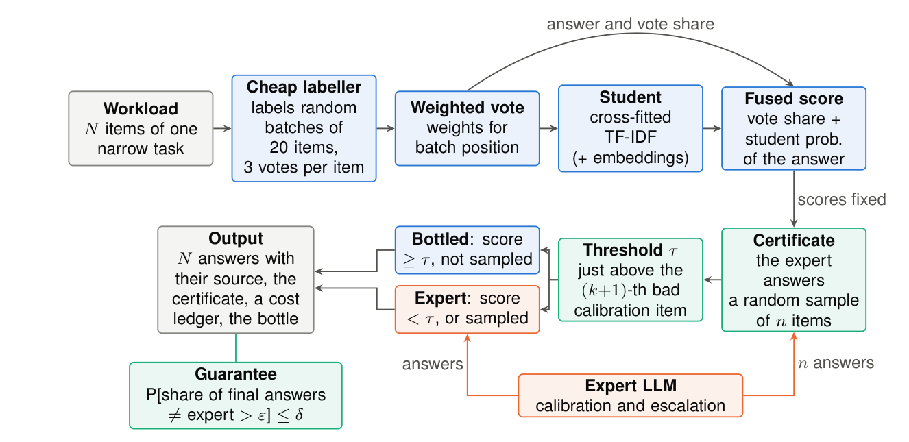
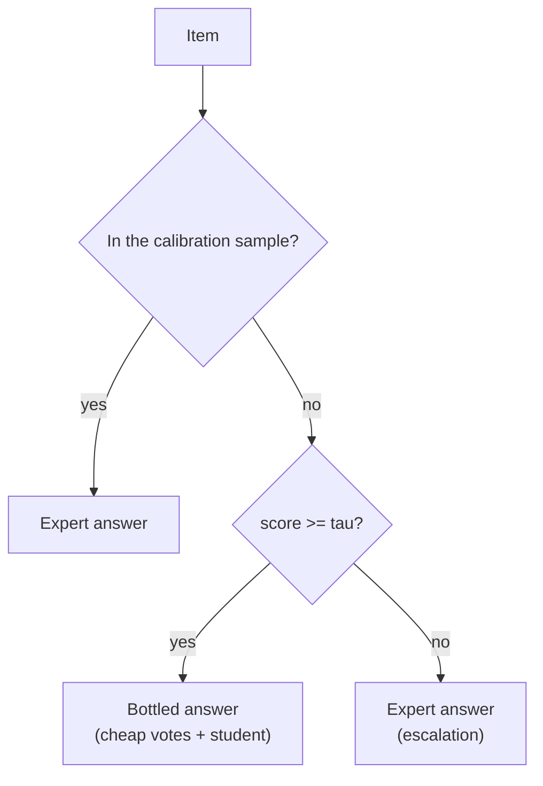
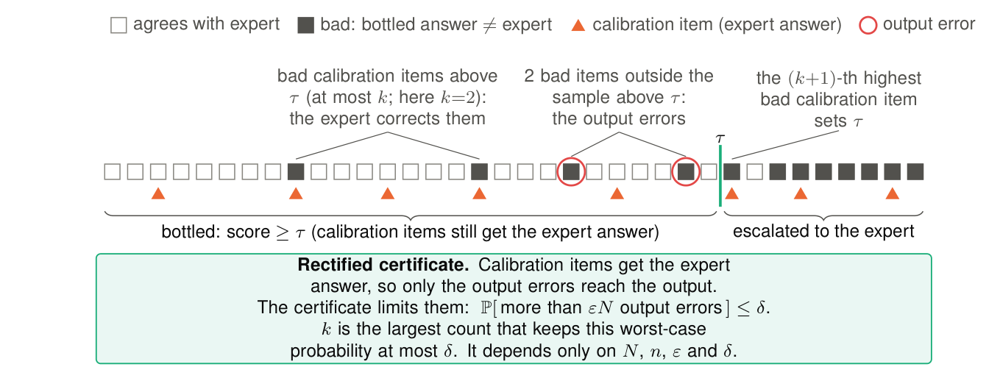

# bottlekit

[](LICENSE)


**Certified bottling of repetitive LLM classification workloads.**

Many LLM workloads repeat one narrow classification task over many items: tag a ticket, route a query, label a review.
An expensive expert model gives good answers, but it is slow and costly when you ask it about every item.

bottlekit lets a cheap model and a small student answer part of the items, and it sends the rest to the expert. You set
two limits, and bottlekit gives each workload a certificate:

> **P[ share of final answers that differ from the expert > eps ] <= delta**

The certificate is exact for the N items of the workload. It does not assume that the items are independent or come
from a fixed distribution. A student trained on the certified answers (the **bottle**) then answers later workloads,
each with its own fresh certificate.



## Contents

* [Features](#features)
* [Results](#results)
* [Install](#install)
* [Quick start](#quick-start)
* [How it works](#how-it-works)
* [Outputs](#outputs)
* [What the guarantee says](#what-the-guarantee-says)
* [Documentation](#documentation)
* [Project layout](#project-layout)
* [Development](#development)
* [Citation](#citation)
* [License](#license)

## Features

* **Exact per-workload guarantee.** The finite-population certificate uses the exact hypergeometric worst case. The
  expert answers of the calibration sample stay in the output, so the certificate counts only the errors that reach
  the output.
* **Works with any OpenAI-compatible endpoint.** vLLM, LM Studio, OpenRouter, OpenAI or your own proxy. Models are
  aliases in one YAML file.
* **Cheap labels that you can trust more.** Random batches, 3 votes per item, position-balanced contexts, and votes
  weighted by the measured reliability of each batch position (no labels needed).
* **Reuse with a fresh certificate.** A bottle answers new workloads cold (bottle alone) or warm (bottle and fresh
  cheap votes). Each pour updates the bottle with its certified answers.
* **Streams.** `BottleSession` collects small submissions into certifiable batches, checkpoints them crash-safely and
  reports the stream totals and the exact worst-case law of the stream.
* **Cost ledger and risk profile.** Each result has the cost per phase, the exact worst-case law of its error count,
  and a report-only health check (agreement with the expert, a precision bound, drift).
* **Offline replay benchmark.** Score a change on stored model outputs, with no model calls.

## Results

From the paper, on an offline replay benchmark (4 tasks: agnews, emotion, esci, banking77; 1,200 items each; 8 seeds),
with eps = 0.05 and delta = 0.1:

| Measure | Value |
|---|---|
| Bottled share (items answered without the expert) | **0.271** (0.261 over all 160 workloads) |
| Cost, relative to the expert on every item (API list prices) | **0.801** |
| With sentence embeddings in the student | 0.322 bottled, 0.751 cost |
| Learn-then-Test (binomial bound) at the same nominal delta | 0.241 bottled |
| Learn-then-Test at the same worst-case level | 0.270 bottled |
| Workloads that exceed eps (delta = 0.1) | 12 of 160 (the design expects about 15.5) |
| Next pour after the bottle learns from one pour, against a frozen bottle | +6.4 points bottled |
| 15 recorded workloads from 5 other tasks | 0.396 bottled, 1 workload exceeds eps |

The design was chosen on the same 4 tasks, so the benchmark results are in-sample. The gain over Learn-then-Test comes
from the exact accounting, which lets you spend almost all of delta.

## Install

Python 3.11 or later.

```bash
git clone https://github.com/RakhilML/Certified-bottling.git
cd Certified-bottling
pip install -e .                 # the library and the `bottlekit` command
pip install -e ".[datasets]"     # optional: public tasks from the Hugging Face hub (load_workload, --task)
pip install -e ".[dev]"          # optional: pytest
```

`scikit-learn` is pinned to 1.8.0, because the pinned outputs in `tests/` were made with that version.

## Quick start

### 1. Offline demo (no models, no network)

```bash
python examples/offline_demo.py
```

A simulator replaces the cheap model and the expert. The demo does a cold start on 1,200 items, then a cold pour of the
bottle on 1,200 new items, and prints the certificate, the bottled share and the cost of each step.

### 2. Connect your models

Copy `bottlekit/models.yaml` and set your endpoint, model ids and prices:

```yaml
defaults:
  base_url: http://localhost:8000/v1        # any OpenAI-compatible server

models:
  cheap:  {id: my-small-model, price_in: 0.05, price_out: 0.10}
  expert: {id: my-large-model, price_in: 0.40, price_out: 1.60}

  # A hosted provider: put the key in an environment variable and give its NAME.
  # expert: {id: provider/model, base_url: https://openrouter.ai/api/v1, api_key_env: OPENROUTER_API_KEY,
  #          price_in: 0.40, price_out: 1.60}
```

Set real prices. The automatic decisions (`mode="auto"`, `votes="auto"`) compare costs.

### 3. Python

```python
import asyncio
from bottlekit import BottleConfig, Bottler, LLMClient, TaskSpec, from_jsonl, load_models

spec = TaskSpec(
    name="tickets",
    instruction="Classify the support ticket.",
    labels={"billing": "billing: charges, invoices, refunds",
            "delivery": "delivery: shipping, parcels, tracking",
            "account": "account: login, password, profile",
            "technical": "technical: errors, crashes, bugs"},
)

async def main():
    workload = from_jsonl(spec, "tickets.jsonl")                  # one {"text": ...} per line
    client = LLMClient(load_models("my_models.yaml"), cache_path=".cache.sqlite")
    cfg = BottleConfig(cheap="cheap", expert="expert", eps=0.05, delta=0.1)

    first = await Bottler(client, spec, cfg).run(workload.texts[:2000])     # cold start
    print(first.certificate["guarantee"], first.coverage())

    later = await Bottler(client, spec, cfg).pour(first.artifact, workload.texts[2000:])   # reuse
    print(later.certificate["guarantee"], later.coverage())
    later.artifact.save("bottle.pkl")
    await client.close()

asyncio.run(main())
```

`examples/quickstart_endpoint.py` is the same flow as a script.

### 4. Command line

```bash
bottlekit run  --jsonl tickets.jsonl --labels billing,delivery,account,technical \
               --instruction "Classify the support ticket." \
               --models my_models.yaml --cheap cheap --expert expert --eps 0.05 --delta 0.1 \
               --save-artifact bottle.pkl --out run.json

bottlekit pour --artifact bottle.pkl --jsonl new_tickets.jsonl --labels billing,delivery,account,technical \
               --instruction "Classify the support ticket." \
               --models my_models.yaml --expert expert --cheap cheap --votes auto \
               --save-artifact bottle_v2.pkl --out pour.json

bottlekit tasks          # public tasks for --task (needs the [datasets] extra)
```

Every `BottleConfig` field has a flag. `bottlekit run --help` lists them with their defaults.

## How it works

1. **Vote.** The cheap model labels the items in random batches of 20, 3 times per item. A weighted vote gives one
   answer per item.
2. **Distil.** A cross-fitted TF-IDF student (optionally with fixed embeddings) learns from the cheap labels. No student
   scores an item that it saw in training.
3. **Score.** Fused score = vote share of the answer + student probability of that answer.
4. **Certify.** The expert answers a uniform random sample of about 1.25 x sqrt(N / eps) items. The threshold tau sits
   just above the (k+1)-th wrong sampled answer, where k is the largest count that keeps the exact worst-case failure
   probability at or below delta.
5. **Escalate.** Items below tau go to the expert. The sampled items keep their expert answers.





Reuse follows the same steps. The bottle scores the new items (alone, or with fresh cheap votes), and a fresh
calibration sample certifies the new workload. The certified answers then update the bottle.


## Outputs

`run` and `pour` return a `BottleResult`:

| Field | Content |
|---|---|
| `answers` | One final answer per item. |
| `provenance` | The source of each answer: `bottle`, `expert_calibration`, `expert_escalation`, `memo`, or `...+fallback`. |
| `certificate` | `guarantee` (the statement in words), `eps`, `delta`, `tau`, `n_cal`, `N`, `certified`, and `risk` (the exact worst-case law: `expected_eps_bound`, `eps_at_delta`, `tail`). |
| `ledger` | Calls, tokens and USD per phase (`cheap_vote`, `cheap_build`, `expert_calibration`, `expert_escalation`). |
| `diagnostics` | Mode, plan, cold-start check, forecast and the `health` report. |
| `artifact` | The bottle (`BottleArtifact`): `save(path)`, `BottleArtifact.load(path)`. |

`result.coverage()` is the bottled share. `result.to_json()` gives everything except the bottle as JSON.

## What the guarantee says

| It says | It does not say |
|---|---|
| At most a share eps of the final answers differ from the **expert**, with probability at least 1 - delta. | That the answers are **correct**. If the expert is wrong, the output is wrong in the same way. |
| It holds for **each workload**, whatever its items are. | That a given item, or a part of the workload, meets eps. |
| The probability is over the calibration sample that bottlekit draws. | That no workload in a long stream fails. At delta = 0.1, about 1 in 10 can fail in the worst case. |

Two rules keep it valid:

* Fix eps, delta, the models and every setting **before** the workload. Do not change them after you see its expert
  answers.
* Do not tune anything (prompts, students, embeddings) on the expert answers of the calibration sample.

Expert replies that cannot be parsed are not covered. bottlekit adds them to the certified eps and says so.

## Documentation

| Page | Content |
|---|---|
| [docs/concepts.md](docs/concepts.md) | The pipeline, the certificate, the risk profile, the expert budget and the modes. |
| [docs/configuration.md](docs/configuration.md) | The models file, every important `BottleConfig` field and the task definition. |
| [docs/reuse-and-streams.md](docs/reuse-and-streams.md) | Pours, large pours, recurring items, `BottleSession` and the health report. |
| [benchmarks/README.md](benchmarks/README.md) | The offline replay benchmark and its data format. |
| [examples/](examples/) | The offline demo and the endpoint quick start. |

## Project layout

```
bottlekit/
├── bottlekit/                 the library
│   ├── harness.py             Bottler: run(), pour(), BottleConfig, BottleArtifact, health report
│   ├── certify.py             exact finite-population certificates, risk profiles, stream laws
│   ├── labeling.py            batched cheap labelling, balanced contexts, weighted votes
│   ├── students.py            TF-IDF (+ dense) student and cross-fitting
│   ├── economics.py           cost model and the automatic decisions
│   ├── session.py             BottleSession: certified streams with checkpoints
│   ├── llm.py                 async client for OpenAI-compatible endpoints, cost ledger, cache
│   ├── tasks.py               TaskSpec, prompts, parsers, loaders, public task registry
│   ├── __main__.py            command line (bottlekit run | pour | tasks)
│   └── models.yaml            example models file
├── tests/                     unit, exhaustive-enumeration and Monte Carlo tests (mock models, no network)
├── benchmarks/                offline replay benchmark
├── examples/                  offline demo and endpoint quick start
├── docs/                      documentation and diagrams
├── pyproject.toml
├── CITATION.cff
├── LICENSE                    Apache-2.0
└── NOTICE
```

## Development

```bash
pip install -e ".[dev]"
pytest                          # the full suite (mock models only; it takes several minutes)
pytest tests/test_bottlekit.py  # a fast subset
```

The tests need no server and no network. Some tests compare the code with pinned outputs in `tests/data/`. A few
tests compare with an older copy of the code or with private replay data. They skip when that is not available.

## Citation

If you use bottlekit, please cite the paper:

```bibtex
@article{ml2026certifiedbottling,
  title   = {Certified Bottling of Repetitive LLM Classification Workloads:
             A Rectified Finite-Population Certificate and Certified Reuse},
  author  = {M L, Rakhil},
  year    = {2026},
  journal = {arXiv preprint},
  note    = {arXiv identifier to be added}
}
```

GitHub also reads [CITATION.cff](CITATION.cff).

## License

The code is licensed under the [Apache License 2.0](LICENSE). See [NOTICE](NOTICE).

The paper is licensed separately under CC BY-NC-SA 4.0.
