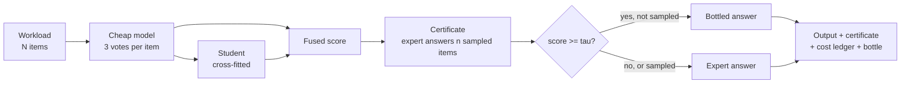

# How bottlekit works

This page tells you what bottlekit does to one workload, and what its guarantee says.

## Terms

| Term | Meaning |
|---|---|
| Workload | A batch of N items for one narrow classification task (one instruction, one label set). |
| Expert | The expensive model. Its answers are the reference. |
| Cheap model | A small model that labels items in batches of about 20. |
| Student | A small TF-IDF classifier (optionally with fixed text embeddings) trained on the cheap labels. |
| Score | A number per item: how sure the pipeline is about its own answer. |
| Calibration sample | n items, drawn uniformly at random, that the expert answers. |
| Threshold (tau) | Items with a score at or above tau keep the pipeline's answer. The other items go to the expert. |
| Bottled item | An item that the pipeline answers without the expert. |
| Bottle | The student trained on the certified answers. It answers later workloads. |
| Pour | One reuse of a bottle on a new workload. |
| eps, delta | Your limits: the allowed error share, and the allowed failure probability. |

## The pipeline

1. **Vote.** The cheap model labels the items in random batches. Each item gets 3 votes from 3 different batch
   contexts. The contexts are balanced, so no item sits at the start of a batch more than once (weak models make more
   errors there). A weighted vote gives one answer per item.
2. **Distil.** A student learns from the cheap labels. Cross-fitting makes sure that a student never scores an item
   that it saw in training.
3. **Score.** The fused score of an item is the vote share of its answer plus the student probability of that answer.
4. **Certify.** The expert answers a uniform random sample of n items. The certificate uses these answers to set the
   threshold tau.
5. **Escalate.** The expert answers every item below tau. The items at or above tau keep their bottled answer. The
   sampled items always keep the expert answer.

The scores are fixed before the calibration sample is drawn. No step chooses a value from the expert answers of the
sample, except the threshold rule itself.

## The guarantee

For each workload, bottlekit certifies:

> P[ share of final answers that differ from the expert > eps ] <= delta

The probability is over the random calibration sample of this workload. The workload itself can be anything: the
guarantee does not assume that the items are independent or that they come from a fixed distribution.

### Why it is exact

* **Rectified.** The sampled items get the expert answer, so they can never be errors in the output. The certificate
  counts only the bad items outside the sample (a bad item is a bottled answer that differs from the expert).
* **Finite population.** The workload has exactly N items. The number of bad items in the sample follows a
  hypergeometric law. bottlekit computes the worst case of that law exactly. It does not use a normal approximation or
  a union bound.
* **The k-rule.** Sort the sampled items by score. The threshold sits just above the (k+1)-th bad sampled item. k is
  the largest number that keeps the worst-case failure probability at or below delta. k depends only on N, n, eps and
  delta. No label enters it.
* **Sample size.** By default n is about 1.25 x sqrt(N / eps), in one look at the full delta. The size is tuned to the
  saw-tooth shape of the exact test before any label is seen.

### What the guarantee does not say

* It compares the answers with the **expert**, not with the truth. If the expert is wrong, the output is wrong in the
  same way.
* It holds **per workload**. It is not a statement about one item or about one part of a workload.
* It is a **probability**. At delta = 0.1, about 1 workload in 10 can exceed eps in the worst case.
* An expert answer that cannot be parsed is an error that the certificate does not cover. bottlekit adds these to the
  certified eps and says so in the certificate.
* If you choose eps, delta, the models or any setting after you look at the expert answers of a workload, the
  guarantee for that workload is lost.

## The risk profile

Each certificate also has a `risk` block. It gives the exact worst-case law of the error count of the output:

| Key | Meaning |
|---|---|
| `expected_eps_bound` | Upper bound on the expected error share. |
| `eps_at_delta` | For each level d: the smallest error share whose worst-case tail is at most d. |
| `tail` | Upper bounds on P[error share > eps'] for a grid of eps'. |
| `delta_spent` | The failure probability that the design actually uses (at most delta). |

## Expert budget

`BottleConfig(expert_budget=B)` limits the escalation calls. When the budget binds, only the least sure items (at most B)
go to the expert, and the certificate reports the eps that it can certify (`eps_achieved`). With a budget, the
k-rule and the budget test each run at delta/2, so the claim made holds at delta whichever of the two the labels select.

## Modes

| Mode | Scores from | Use it when |
|---|---|---|
| `fused` | Cheap votes on every item plus the student | The expert is much more expensive than the cheap model. |
| `student` | The student alone, trained on cheap labels of a subset | The cheap model is not much cheaper than the expert. |
| `auto` (default) | The cost rule in `bottlekit.economics` picks one of the two | You set real prices in `models.yaml`. |

With zero expert prices, `auto` can never choose cheap votes. bottlekit gives a warning in that case.
