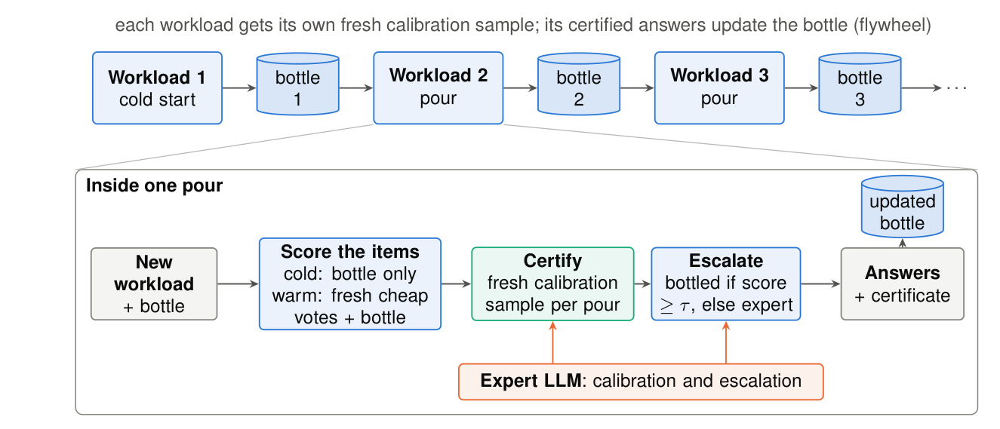
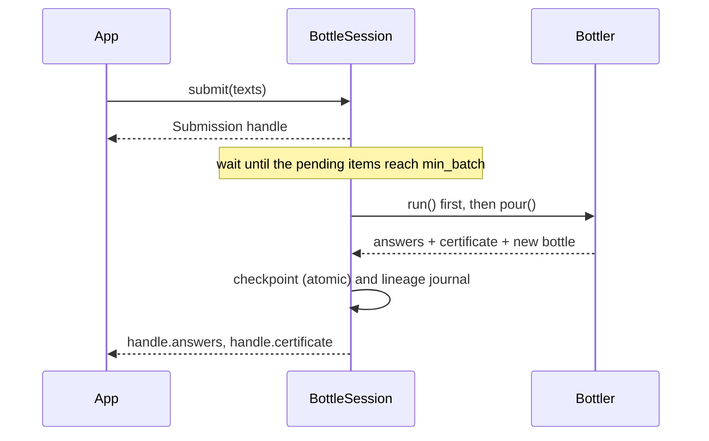

# Reuse, streams and health

## Reuse a bottle (pour)

A cold start (`run`) exports a **bottle**: a student trained on the certified answers. `pour` uses the bottle on a new
workload. Each pour draws its **own fresh calibration sample**, so each pour has the same guarantee as a cold start.
The pour does not assume that the new items look like the old ones.



```python
from bottlekit import BottleArtifact, Bottler

bottle = BottleArtifact.load("bottle.pkl")
res = await Bottler(client, spec, cfg).pour(bottle, new_texts, votes="auto")
res.artifact.save("bottle_v2.pkl")       # the bottle, updated with the certified answers of this pour
```

| `votes` | What scores the items |
|---|---|
| `False` | Cold pour: the bottle alone. No cheap-model calls. |
| `True` | Warm pour: fresh cheap votes fused with the bottle. |
| `"auto"` | Warm if the forecast in the bottle predicts a lower cost, else cold. The forecast uses earlier workloads only. |

The certified answers of each pour go back into the bottle (the flywheel). The next pour starts from a better bottle.

### Large pours

A cold pour that is much larger than the bottle's memory (N >= 4 x memory, `chunking="cold"`) is split into chunks.
Each chunk is an ordinary pour of the bottle that the previous chunk updated. The whole workload keeps
P[share > eps] <= delta: bottlekit computes the exact law of the total error count by convolution of the per-chunk
worst-case laws, and it checks the bound before chunk 1 starts. The plan depends only on N, the memory size and the
settings.

### Recurring items (memo)

With `memo=True`, a pour answers an item from the bottle's memory when the bottle holds an expert answer for the same
prompt. Only the other items are scored and certified. This assumes a **deterministic expert** (temperature 0, the same
model). A different prompt, parser or model changes the expert fingerprint, and the memo is then off.

## Streams (BottleSession)

`BottleSession` runs a stream of submissions. It collects small submissions into batches that are large enough to
certify, and it certifies each batch with `run` or `pour`.



```python
from bottlekit import BottleSession

session = BottleSession(client, spec, cfg, state_path="stream.json")   # min_batch="auto"
handle = await session.submit(texts)
await session.flush(force=True)          # certify what is pending now (see the note below)
print(handle.answers, handle.certificate["guarantee"])
print(session.report()["statement"])
```

* **The certified unit is the flushed batch.** A submission inside a larger batch has no guarantee of its own.
* **Batch sizes are label-free.** The session flushes at `min_batch` items (by default the smallest size with a
  calibration share of at most 30%). Flush times depend only on submission sizes and on your explicit `flush` calls.
  If you force a flush, decide when to do it before you see any answer.
* **Lineage guard.** No calibration stream is used twice. A stale or swapped checkpoint stops with an error before any
  model call.
* **Crash safety.** `BottleSession.resume("stream.json", client, spec, cfg)` continues from the last checkpoint and
  gives the same results as a stream without the crash.
* **Growing batches.** `batch_growth=g` lets the flush size grow with the bottle (up to `max_batch`). Larger batches
  pay a smaller calibration share, but submissions wait longer.

### Stream report

`session.report()` gives one row per batch (size, bottled share, expert calls, cost by phase) and stream totals. The
totals add up the per-batch statements:

* the expected number of bottled answers that differ from the expert is at most the sum of the per-batch bounds;
* the expected number of batches that exceed eps is at most the sum of their delta.

The stream ledger also gives the exact worst-case law of the error share of the **whole stream**. It is a convolution
of the per-batch laws. It is available when the batch designs did not depend on labels.

## Health report

Each workload gets `diagnostics["health"]` (turn it off with `health=False`). It never changes an answer or a decision.

| Part | Meaning |
|---|---|
| Agreement | How often each answer source (cheap vote, student, bottle, final answer) agrees with the expert on the calibration sample, with exact intervals. |
| Precision bound | A lower bound on the share of bottled answers that agree with the expert, from the same worst-case law as the certificate. |
| Drift | Label-free statistics of a pour: confidence of the bottle on the new items and similarity to its memory. |
| Learning curve | One row per certified workload in `bottle.history`. |

```python
from bottlekit import format_learning_curve

print(format_learning_curve(bottle))
```
